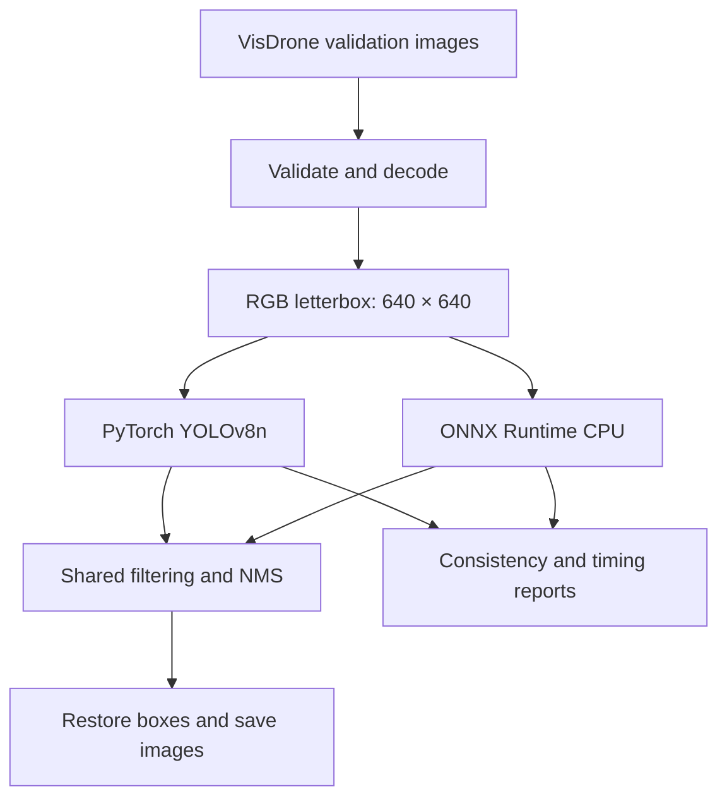
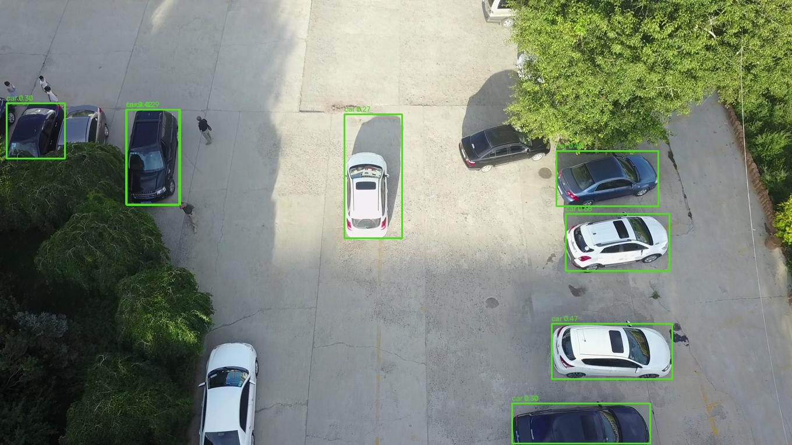
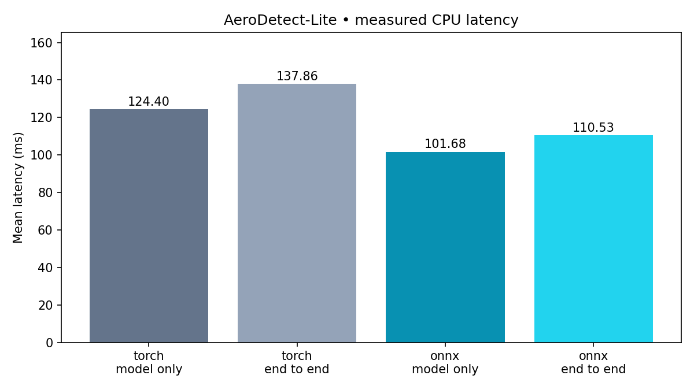

# AeroDetect-Lite
### Efficient drone image object detection with ONNX Runtime

A small, reproducible Python project for exploring how a pretrained object detector behaves when exported from PyTorch to ONNX Runtime on a CPU.

Drone photographs often contain tiny vehicles, crowded streets, shadows and objects at very different scales. This project helps students and computer-vision developers inspect those challenges and measure deployment performance without needing a drone or GPU. It is an offline image-processing prototype, not a flight or surveillance platform.

## What works

- Loads JPEG/PNG images with missing-file, signature and file-size validation.
- Preserves VisDrone filenames, dimensions, ground-truth fields and file hashes in a fixed manifest.
- Runs pretrained YOLOv8n through PyTorch and an independent ONNX Runtime CPU implementation.
- Uses shared letterboxing, confidence filtering, class-aware NMS and original-coordinate box restoration.
- Saves genuine annotated images and JSON predictions.
- Checks graph validity, backend output agreement and measured latency.
- Includes focused pytest tests, raw measurements and beginner-friendly interview preparation.

## Workflow



## Model and stack

Python, NumPy, OpenCV, PyTorch, Ultralytics, ONNX, ONNX Runtime, Matplotlib and pytest. The model is **Ultralytics YOLOv8n, COCO pretrained**, sourced from the `v8.3.0` assets release. It was not trained by the project author. The original network has 80 COCO classes; the display selects person, bicycle, car, motorcycle, bus and truck. Full class names and SHA-256 hashes are in `outputs/export.json`.

Export uses the official Ultralytics API, FP32, static batch one, 640×640, opset 17, `nms=False` and `simplify=False`. Input is `[1,3,640,640]`; raw output is `[1,84,8400]`. No separate objectness multiplication is used for this YOLOv8 output. ONNX checker validates the graph; the actual CPU session verifies operator support. The export report lists the operators.

Model and source license: AGPL-3.0 (see LICENSE); Ultralytics also offers enterprise licensing. Dataset terms are separate.

## Installation — Windows PowerShell or Linux

Use Python 3.12. From the extracted `AeroDetect-Lite` directory:

```powershell
python -m venv .venv
```

Windows activation: `.\.venv\Scripts\Activate.ps1`  
Linux activation: `source .venv/bin/activate`

```powershell
python -m pip install --upgrade pip
python -m pip install torch==2.15.0 torchvision==0.29.2 --index-url https://download.pytorch.org/whl/cpu
python -m pip install -r requirements.txt
python -m pytest -v
```

The supplied package versions are the versions used in this Linux run. Windows execution is not verified. If running on Colab, upload/extract the project, use `%cd` to enter its folder, install requirements with `%pip`, and run the same commands with `!python`. This task did not access a Colab runtime.

For inference alone, after obtaining the exported ONNX file, only NumPy, OpenCV and ONNX Runtime are needed. `scripts/run.py infer --backend onnx` does not import PyTorch or Ultralytics.

## Dataset setup

Use **VisDrone2019-DET validation**, from the [official repository](https://github.com/VisDrone/VisDrone-Dataset) and its download links. This execution used the [Ultralytics-hosted validation archive](https://github.com/ultralytics/assets/releases/download/v0.0.0/VisDrone2019-DET-val.zip). It is an attributed mirror of the dataset, not a new dataset.

Place the extracted `VisDrone2019-DET-val` folder under `data/`. It must contain `images/` and `annotations/`. No absolute dataset path is built into the code.

The included `config/subset.json` freezes ten images, sampled with Python `random.Random(42)` from sorted filenames. Keep this manifest to reproduce the reported experiment. To deliberately create a new subset:

```powershell
python scripts/select_subset.py --dataset data/VisDrone2019-DET-val --count 10 --seed 42
```

This command preserves all eight annotation fields, including score-zero ignored objects and class-zero ignored regions. Annotation SHA-256 hashes and original boxes are recorded. Runtime checks the image hashes before using a manifest.

## Export and run

Download [yolov8n.pt from the v8.3.0 release](https://github.com/ultralytics/assets/releases/download/v8.3.0/yolov8n.pt) into the project folder. Compare its checksum with `outputs/export.json` for exact provenance. The export command can also trigger Ultralytics' automatic model download, but that upstream release can change; use the linked release for this experiment.

```powershell
python scripts/export_model.py --weights yolov8n.pt --size 640
python scripts/run.py infer --backend torch --dataset data/VisDrone2019-DET-val
python scripts/run.py infer --backend onnx --dataset data/VisDrone2019-DET-val
python scripts/run.py compare --dataset data/VisDrone2019-DET-val
python scripts/run.py benchmark --dataset data/VisDrone2019-DET-val --warmup 5 --repeat 5
python scripts/gpu_status.py
```

Default thresholds are confidence 0.25 and NMS IoU 0.45. `--confidence`, `--iou`, `--size`, `--threads`, `--manifest` and `--output` are explicit command options. If changing resolution, re-export at that same resolution. The runtime rejects a mismatched input contract. Predictions use `[x1,y1,x2,y2,confidence,COCO_class_id]` in original-image pixels.

## Sample detection output



The image is an actual inference output. Small objects can be missed or confused. Colored boxes are predictions, not ground-truth labels. Both backends' ten annotated images and JSON detections are included.

## Benchmark methodology

One CPU thread per backend, OpenCV one thread, FP32, batch one, fixed 640×640 input, identical ten-image manifest, five warm-up model calls per backend, five repetitions of every image per scope. Each row therefore has 50 measured observations. Backends run sequentially on the same host; background load and run order can affect results. There are no GPU results.

- **Model-only:** timed backend call, including tensor validation and Python/framework array conversion. Disk reads, preprocessing, NMS and rendering are excluded. It is a deployment-call measurement, not a pure kernel microbenchmark.
- **End-to-end:** file reading/decoding, preprocessing, inference, NMS, box restoration, drawing and JPEG writing. Model loading is excluded. Writes overwrite a scratch benchmark image and are not followed by filesystem `fsync`; OS caching can affect results. Only the model has explicit warm-up, so initial I/O costs may remain.

`outputs/timings.csv` contains raw observations; `outputs/RESULTS.csv` and root `RESULTS.csv` contain aggregate statistics. Throughput is 1000 divided by mean milliseconds, not an independent concurrency test. p95 uses NumPy's linear percentile. Failures are counted and written to `outputs/failures.json`; invalid manifests fail early.


## Executed results

Linux / AMD EPYC 9V74 virtual CPU, 9 logical CPUs available, approximately 9.7 GiB RAM; Python 3.12.14. Both inference backends used one CPU thread. Exact package versions and runtime settings are in `outputs/environment.json`.

| Backend | Scope | Mean ms | Median ms | p95 ms | Images/s |
|---|---|---:|---:|---:|---:|
| torch | model_only | 124.40 | 124.05 | 138.44 | 8.04 |
| torch | end_to_end | 137.86 | 134.83 | 160.74 | 7.25 |
| onnx | model_only | 101.68 | 99.75 | 114.06 | 9.83 |
| onnx | end_to_end | 110.53 | 109.52 | 121.14 | 9.05 |

30 pytest tests passed. All ten images passed raw `allclose` (atol 0.01, rtol 0.001) and final-detection matching (same class, IoU ≥0.99, confidence difference ≤0.001). All 132 detections matched one-to-one. No image-processing failures occurred. These tolerances test numerical deployment consistency, not accuracy.

Checkpoint size: 6,549,796 bytes. ONNX size: 12,824,166 bytes. Export increased file size; ONNX is not a compression claim.



## Accuracy boundaries

**Precision, recall, mAP@0.5 and mAP@0.5:0.95: NOT EVALUATED.** No compatible VisDrone checkpoint was verified for this implementation. This COCO baseline is useful for deployment measurements but is not a full VisDrone detector.

Candidate semantic mappings are COCO bicycle→VisDrone bicycle, car→car, bus→bus, truck→truck. Person is excluded from evaluation mapping because VisDrone separates pedestrian and people; motorcycle is not silently equated with the VisDrone motor label. Van, tricycle and awning-tricycle have no direct selected COCO equivalents. The mapping is documented and tested, but is not used to manufacture mAP.

No custom approximation of the official ignored-region evaluation is presented as a benchmark. A future accuracy study must integrate and validate the [official evaluation toolkit](https://github.com/VisDrone/VisDrone2018-DET-toolkit), including ignored regions, score-zero ground truth, detection limits and class conventions. No ignored annotations are silently deleted from the manifest. Even that future study must label the ten-image result as subset-only. Runtime consistency is a separate check and cannot establish precision or recall.

## TensorRT

**NOT EXECUTED.** See `outputs/gpu_status.json` for the actual hardware check. No compatible NVIDIA GPU was available; no CUDA installation was attempted. The CPU pipeline is complete independently of TensorRT.

On a separately verified supported NVIDIA setup, follow the [official TensorRT guide](https://docs.nvidia.com/deeplearning/tensorrt/latest/) and support matrix. A basic optional engine-build command is:

```text
trtexec --onnx=yolov8n.onnx --saveEngine=yolov8n.engine
```

This is an unexecuted conversion instruction, not a verified integration. Inspect the installed version's flags before selecting precision. A random-input `trtexec` timing is not image accuracy or end-to-end performance. Compare against ONNX CUDA on the same GPU, using real images and checked predictions before making any optimization claim.

## Attribution and license

VisDrone data belongs to the **AISKYEYE team, Lab of Machine Learning and Data Mining, Tianjin University**. The [dataset usage terms](https://aiskyeye.com/data-protection/) specify CC BY-NC-SA 3.0; the [download page](https://aiskyeye.com/download/) identifies the detection set as the same as VisDrone2019. The small annotated derivative examples and annotation subset included here remain under those dataset terms. Changes to images consist of predicted boxes and labels. Source code is AGPL-3.0; this does not relicense the dataset. The full dataset and model weights are excluded from this archive.

References: [YOLOv8](https://docs.ultralytics.com/models/yolov8/), [official export API](https://docs.ultralytics.com/modes/export/), [ONNX Runtime API](https://onnxruntime.ai/docs/api/python/api_summary.html), [Ultralytics licensing](https://www.ultralytics.com/license).

## Limits

COCO-to-aerial distribution shift, missed small objects, crowd suppression and lighting variation remain. These are ten images, not a representative accuracy study. No training, live video, tracking, ROS2, drone hardware, production deployment or real-time guarantee is included. Benchmark results depend on the CPU, library versions, OS and workload.

## GitHub and CI

For Windows setup, GitHub upload and the scope of automatic CI checks, see [GITHUB_SETUP.md](GITHUB_SETUP.md). The workflow at `.github/workflows/ci.yml` is included but its first run on GitHub has **not** yet been observed.
